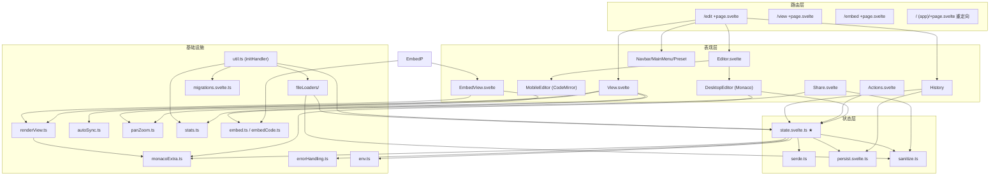

# Mermaid Live Editor — 项目架构报告

> 分析时间：2026-08-19
> 分析范围：`F:\Github\repo\Flow-editor`（完整分析，无采样）
> 证据格式：`文件路径:行号`

---

## 1. 项目快照

| 项 | 值 |
|----|-----|
| 项目名 | `mermaid-live-editor` v2.0.67（`package.json:2-3`） |
| 定位 | 浏览器端 Mermaid 图表实时编辑器 / 分享器 / 嵌入组件（https://mermaid.live） |
| 技术栈 | SvelteKit 2 + Svelte 5（runes）+ TypeScript 6 + Vite 8 + Tailwind CSS 4 |
| 包管理 | pnpm 10.34.5（`package.json:129`），Node >= 24.16.0（`package.json:127`） |
| 部署形态 | 纯静态 SPA（`@sveltejs/adapter-static`，输出 `docs/`，`svelte.config.js:17-20`）；GitHub Pages + Netlify + Docker/nginx 三渠道 |
| 代码规模 | 117 个源文件（59 `.svelte` + 56 `.ts`），`src/` 约 8.5k 行（不含则约 7.8k，`ui/` 组件除外） |
| 核心依赖 | mermaid ^11.16.1、monaco-editor 0.55.1、codemirror 6、pako、js-base64、svg-pan-zoom、hammerjs、svg2roughjs、plausible-tracker（`package.json:91-119`） |
| 贡献者 | Sidharth Vinod（2179 commits）、Knut Sveidqvist（118）、Yash-Singh1（47）+ dependabot/renovate 机器人 |
| 分支策略 | `develop`（日常开发）→ `release-pr.yml` 自动创建 `release-promotion` PR → `master`（发布） |

---

## 2. 目录结构与角色标注

```
Flow-editor/
├── src/
│   ├── embed-loader.ts              # [外部接口层] <mermaid-embed> 自定义元素加载器（编译为 static/embed.js）
│   ├── routes/                      # [入口层] SvelteKit 路由
│   │   ├── +layout.ts               #   prerender=true / csr=true / ssr=false（纯 SPA）
│   │   ├── (app)/
│   │   │   ├── +page.svelte         #   /      → 旧版 hash URL 重定向到 /edit
│   │   │   ├── +layout.svelte       #   布局：hashchange 监听、Service Worker、暗色主题联动
│   │   │   ├── edit/+page.svelte    #   /edit  → 主编辑器（三栏可调布局）
│   │   │   └── view/+page.svelte    #   /view  → 只读预览（noindex）
│   │   └── embed/+page.svelte       #   /embed → 独立嵌入小部件页（不引状态单例）
│   └── lib/
│       ├── components/              # [表现层] 业务组件
│       │   ├── Editor.svelte        #   编辑器分发（桌面 Monaco / 移动 CodeMirror）
│       │   ├── DesktopEditor.svelte #   Monaco 双模型（mermaid.mmd / config.json）+ AI 提示浮层
│       │   ├── MobileEditor.svelte  #   CodeMirror 6（json/markdown 语言仓室切换）
│       │   ├── View.svelte          #   图表画布（绑定全局 validatedState）
│       │   ├── EmbedView.svelte     #   嵌入画布（纯 props 驱动，与编辑器状态隔离）
│       │   ├── Actions.svelte       #   导出 PNG/SVG/剪贴板/Markdown、Gist 加载
│       │   ├── Share.svelte         #   分享对话框（链接 + embed 代码片段生成）
│       │   ├── History/             #   时间线（auto/manual/loader 三槽）
│       │   ├── migration/           #   mermaid.ai 编辑器选择弹窗
│       │   └── ui/                  #   shadcn-svelte 基础组件（vendored，bits-ui）
│       └── util/                    # [基础设施层 + 业务逻辑层]
│           ├── state.svelte.ts      #   ★ 全局状态单例（唯一可变源）
│           ├── serde.ts             #   状态序列化（pako deflate + base64）
│           ├── persist.svelte.ts    #   localStorage 持久化 rune
│           ├── mermaid.ts           #   mermaid 封装（ELK/tidy-tree 布局 + ZenUML 注册）
│           ├── renderView.ts        #   渲染 + DOM 放置 + rough 手绘变换
│           ├── autoSync.ts          #   渲染节流状态机（慢渲染降级）
│           ├── panZoom.ts           #   svg-pan-zoom + hammerjs 触摸封装
│           ├── sanitize.ts          #   配置安全消毒（XSS/原型污染）
│           ├── errorHandling.ts     #   解析错误行号映射
│           ├── embed.ts / embedCode.ts  # 嵌入设置解析 / 片段生成
│           ├── stats.ts             #   Plausible 埋点（含手动防抖）
│           ├── fileLoaders/         #   ?code=/?config=/?gist= URL 加载器
│           ├── migration/           #   域名检测（mermaid.ai vs mermaid.live）
│           ├── migrations.svelte.ts #   localStorage 数据版本迁移
│           └── promos/              #   日期区间推广横幅
├── tests/                           # Playwright E2E（8 个 spec）
├── static/                          # favicon、service-worker.js、PWA manifest
├── vite.config.js                   # 主构建（HMR 禁用→全量刷新、vendor 分块）
├── vite.embed.config.js             # embed-loader 独立 IIFE 构建 → static/embed.js
└── .github/workflows/               # CI/CD（见 03-workflow.md）
```

**分层判定**：本项目是典型的**前端单页应用分层**，而非 MVC/六边形 ——
- 入口层 = SvelteKit 路由（`src/routes/`）
- 表现层 = `src/lib/components/`（Svelte 组件）
- 业务/状态层 = `src/lib/util/state.svelte.ts` 单例 + 各纯函数工具模块
- 数据访问层 = `persist.svelte.ts`（localStorage）、`fileLoaders/`（GitHub Gist API）、`stats.ts`（Plausible）
- 无自建后端；外部服务仅 mermaid.ink（图片渲染）、Kroki、GitHub API、Plausible、mermaid.ai

---

## 3. 核心架构模式（含证据）

### 3.1 单一可变状态源 + 唯一变更网关（Store / Gateway 模式）

`src/lib/util/state.svelte.ts` 是全应用唯一的状态真相源：

```typescript
// state.svelte.ts:34-36 — 唯一可变 $state，初始化自 localStorage 'codeStore'
const input = $state<State>(readJSON(CODE_STORE_KEY, { ...defaultState }));
// state.svelte.ts:41 — 对外只读暴露
export const inputState: Readonly<State> = input;
// state.svelte.ts:135-140 — 所有写操作必须经过的唯一网关
const update = (mutate: (state: State) => void): void => {
  untrack(() => {
    mutate(input);
    persistAndProcess();   // 持久化 + 异步重校验，不可被遗忘
  });
};
```

导出的更新函数（`updateCode:257`、`updateCodeStore:253`、`updateConfig:276`、`replaceInputState:292`、`loadState:228`、`toggleDarkTheme:280`、`verifyState:311`）全部经由 `update()` 收口，保证"变更 → 持久化 → 重校验 → 发布"链路不可绕过。

### 3.2 校验快照发布（单向数据流）

- 写入侧：`input`（`$state`，模块私有）
- 读取侧：`validatedCurrent`（`$state.raw`，整替不深跟踪，`state.svelte.ts:53-55`），经只读 getter `validatedState.current`（`:144-148`）发布，附加 `error` / `errorMarkers` / `serialized` / `diagramType` 字段（`types.d.ts:40-46`）
- `validatedState` 从不持久化、从不外发（注释见 `state.svelte.ts:142-143`）

### 3.3 URL 即分享机制（State-as-URL）

序列化状态镜像进 URL hash（250ms 防抖，`state.svelte.ts:304-309`），格式 `pako:<base64(deflate(JSON))>`（`serde.ts:19-45`），兼容旧版无前缀纯 base64（`serde.ts:57-60`）。PNG/SVG（mermaid.ink）、Kroki、Mermaid Chart 链接全部由 `serialized` 派生（`state.svelte.ts:150-190`）。

### 3.4 观察者/队列模式渲染

`View.svelte:112-117` 用 **Promise 链队列**（`pendingStateChange = pendingStateChange.then(...)`）串行化渲染，避免快速输入下的渲染竞态；`EmbedView.svelte:69-86` 用序号 `renderSeq` 实现"最新获胜"跳过过期渲染。

### 3.5 策略/注册表模式（多处）

- 序列化策略注册表：`serdes: Record<SerdeType, Serde>`（`serde.ts:33-36`）
- 文件加载器注册表：`loaders: Record<string, Loader>` 目前仅 `gist`（`fileLoaders/loader.ts:6-8`）
- 迁移注册表：`migrations: Record<string, () => void>`（`migrations.svelte.ts:9-11`）
- 推广活动注册表：`promotions: Record<string, Promotion>`（`promos/promo.svelte.ts:18-31`）

### 3.6 类封装的命令式子系统

`PanZoomState`（`panZoom.ts:7-157`，包裹 svg-pan-zoom + hammerjs）、`AIPromptViewZoneManager`（`AIPromptViewZoneManager.ts:3-71`，Monaco view zone 生命周期）——对 imperative 第三方库做类封装，通过回调 `onPanZoomChange`（`panZoom.ts:15`）回流状态。

### 3.7 双编辑器策略

`Editor.svelte:44-48` 按 `isMobile`（视口 < 640px，`edit/+page.svelte:55`）分发 `DesktopEditor`（Monaco，含 mermaid 自定义语言、补全、错误标记，`monacoExtra.ts:7-`）或 `MobileEditor`（CodeMirror 6，`MobileEditor.svelte:33-70`）。两者编辑同一个 `validatedState`，按 `editorMode`（`'code' | 'config'`，`types.d.ts:89`）切换图代码或 Mermaid 配置 JSON。

---

## 4. 模块依赖图（核心）



关键依赖方向：
- 路由层 → 组件层 → 状态层 → 基础设施，**严格单向**，无反向依赖
- 特意切断的依赖：`EmbedView.svelte` 注释明令"必须永不导入编辑器状态单例：无 localStorage、无 URL 重写、无埋点"（`EmbedView.svelte:9-11`），实现嵌入页与编辑器状态隔离
- `util.ts#initHandler`（`util.ts:26-37`）是应用启动编排器，串起 migrations → URL 加载 → gist 加载 → hash 订阅 → 埋点

---

## 5. 核心数据结构

### 5.1 `State`（`types.d.ts:25-38`，可持久化、可序列化进 URL）

| 字段 | 类型 | 说明 |
|------|------|------|
| `code` | `string` | Mermaid 图代码 |
| `mermaid` | `string` | Mermaid 配置（JSON 字符串） |
| `updateDiagram` | `boolean` | 手动/自动同步开关 |
| `rough` | `boolean` | 手绘模式（svg2roughjs） |
| `renderCount?` | `number` | 渲染计数（新字段必须可选，兼容旧存档，`types.d.ts:30`） |
| `panZoom?` / `grid?` / `editorMode?` | — | 视图选项 |
| `pan?` / `zoom?` | `{x,y}` / `number` | 视口位置 |
| `loader?` | `LoaderConfig` | 来源（gist / files） |

### 5.2 `ValidatedState`（`types.d.ts:40-46`，运行时派生，不持久化）

`State` + `editorMode`（必有）+ `diagramType?` + `error?` + `errorMarkers: MarkerData[]` + `serialized: string`

### 5.3 `HistoryEntry`（`types.d.ts:69-79`）

`{ id: uuid, state, time, url?, name? }` × 三种类型槽 `auto | manual | loader`（`historyState.svelte.ts:11-14`）

---

## 6. 技术栈全景与版本

| 类别 | 选型 | 版本约束 | 证据 |
|------|------|---------|------|
| 框架 | SvelteKit（adapter-static） | ^2.63.1 | `package.json:39` |
| UI 运行时 | Svelte 5（runes API：`$state`/`$derived`/`$effect`/`untrack`） | ^5.56.4 | `package.json:74` |
| 语言 | TypeScript | ^6.0.3 | `package.json:83` |
| 构建 | Vite（含 test 配置内联） | ^8.0.16 | `package.json:86` |
| 样式 | Tailwind CSS（`@tailwindcss/vite` 插件式） | ^4.3.2 | `package.json:82` |
| 组件库 | shadcn-svelte（bits-ui ^2.18.1、paneforge 可调面板） | — | `package.json:50,70` |
| 图表引擎 | mermaid + layout-elk + layout-tidy-tree + mermaid-zenuml | ^11.16.1 | `package.json:103-110` |
| 桌面编辑器 | monaco-editor | 0.55.1（锁定） | `package.json:112` |
| 移动编辑器 | codemirror 6 系（json/markdown/yaml 语言包） | ^6.x | `package.json:92-97` |
| 序列化 | pako 2.1.0（锁定）+ js-base64 3.7.8（锁定） | — | `package.json:108,113` |
| 视图交互 | svg-pan-zoom 3.6.2（锁定）+ hammerjs 2.0.8 | — | `package.json:107,109` |
| 手绘 | svg2roughjs ^3.2.3 | — | `package.json:117` |
| 埋点 | plausible-tracker ^0.3.9 | — | `package.json:114` |
| 单测 | vitest ^4.1.10 + jsdom + @vitest/coverage-v8 | — | `package.json:47-48,66,88` |
| E2E | Playwright ^1.60.0（仅 chromium） | — | `package.json:37`、`playwright.config.ts:5-10` |
| 质量 | ESLint 10 + prettier 3 + husky/lint-staged | — | `package.json:56,71,65` |

**锁定版本说明**：monaco/pako/js-base64/svg-pan-zoom/uuid 用精确版本（无 `^`），因为这些直接参与序列化格式或渲染正确性，升级需人工评估。

---

## 7. 构建配置要点

1. **HMR 强制禁用**：`alwaysFullReload` 插件把所有热更新转为整页刷新（`vite.config.js:12-18`），注释明示"HMR 会造成状态不一致"。
2. **双构建管线**：
   - 主构建：`vite build` → `docs/`（GitHub Pages 约定，CLAUDE.md 明令禁止手改）
   - embed 构建：`vite build --config vite.embed.config.js` → `static/embed.js`（IIFE、**不压缩** `minify: false`，`vite.embed.config.js:6-18`），`pnpm dev`/`pnpm build` 均先跑 `build:embed`（`package.json:7,10`）
3. **vendor 分块**：monaco/mermaid/codemirror 固定进命名 chunk 以便长缓存（CLAUDE.md「Environment / build quirks」节）。
4. **环境变量前缀** `MERMAID_`（`vite.config.js:33`），运行时经 `env.ts:1-10` 读取，控制渲染服务、Kroki、埋点、Mermaid Chart 开关。
5. **路径别名** `$/*` → `src/lib/*`（`svelte.config.js:11-13`），与 SvelteKit 内置 `$lib` 并存。
6. **base path** 可由 `MERMAID_BASE_PATH` 注入（`svelte.config.js:14-16`），支持子路径部署。

---

## 8. 显著设计决策与权衡

| 决策 | 位置 | 动机 |
|------|------|------|
| 所有状态写入收口单一 `update()` 网关并 `untrack` | `state.svelte.ts:131-140` | 防止 effect 意外订阅输入态导致回环；防止新增更新函数忘记持久化/重校验（近期重构 commit `d2f067a5`） |
| `validatedCurrent` 用 `$state.raw` 整替 | `state.svelte.ts:52-55` | 快照只整替不局部改，浅响应足够且更快 |
| 移动编辑器 `currentText` 故意不用 `$state` | `MobileEditor.svelte:18-21` | 同步 effect 既读又写，响应式会造成击键被回滚（commit `144b4dc1` 修复） |
| embed 页永不导入状态单例 | `EmbedView.svelte:9-11`、`embedCode.ts:9-12` | iframe 与编辑器共享 origin（sandbox 需 `allow-same-origin`），靠代码隔离而非 opaque origin 保证 localStorage 不被嵌入页读写 |
| 埋点 URL 永远剥离 hash | `stats.ts:31-33` | hash 含图数据，隐私承诺"图内容永不离开浏览器"（`Share.svelte:73-75`） |
| 手动埋点防抖按事件分级 | `stats.ts:89-132` | render 类 5 分钟、普通 1 分钟、点击类 0，控制上报量 |
| ZenUML 之后强制整页刷新 | `state.svelte.ts:66-69` | 临时 hack，ZenUML 外部图渲染后污染 mermaid 状态 |

---

## 9. 函数级调用链（关键路径示例）

### 9.1 输入变更链（用户击键 → 状态发布）

```
Monaco onDidChangeModelContent        DesktopEditor.svelte:144-151
  └─> onUpdate(text)                  Editor.svelte:15-21（按 editorMode 分流）
      ├─ code 模式: updateCode(text)            state.svelte.ts:257-274
      └─ config 模式: updateConfig(text)        state.svelte.ts:276-278 → updateCodeStore
          └─> update(mutate)                    state.svelte.ts:135-140  [untrack]
              ├─> mutate(input)                 （写 code / mermaid / pan / zoom…）
              └─> persistAndProcess()           state.svelte.ts:122-129
                  ├─> $state.snapshot(input)
                  ├─> writeJSON('codeStore', snapshot)     persist.svelte.ts:29-33
                  └─> processState(snapshot) [async]       state.svelte.ts:59-113
                      ├─> serializeState(state)            serde.ts:38-45 → "pako:…"
                      ├─> parse(state.code)                mermaid.ts:23-25 → mermaid.parse
                      ├─ 失败分支: errorHandling.extractErrorLineText:37
                      │          findMostRelevantLineNumber:2（O(n·L³) 子串匹配）
                      │          replaceLineNumberInErrorMessage:26 → errorMarkers
                      └─> validatedCurrent = processed      （$state.raw 整替）
                          └─> updateHash?.(serialized)     debounce 250ms → history.replaceState
```

### 9.2 渲染链（validatedState → SVG 上屏）

```
View.svelte $effect                     View.svelte:113-117
  └─> pendingStateChange 队列（串行化）
      └─> handleStateChange(state)      View.svelte:43-105
          ├─ state.error 存在 → error=true, return（画布降透明度）
          ├─ 去重检查: code/config/rough/panZoom 均未变 → return   :56-62
          ├─ shouldRefreshView()        autoSync.ts:25-39（慢渲染>150ms 降级为 1s 防抖批量）
          ├─ mayContainFontAwesome(code) → waitForFontAwesomeToLoad  View.svelte:73-75
          ├─> renderAndPlaceDiagram()   renderView.ts:18-68
          │   ├─> render(config, code, viewId)   mermaid.ts:11-21
          │   │    ├ mermaid.initialize(config)
          │   │    └ mermaid.render(id, code) → { svg, bindFunctions, diagramType }
          │   ├ container.innerHTML = svg
          │   ├ rough 分支: Svg2Roughjs(containerSelector).sketch()  renderView.ts:43-59
          │   └ 尺寸修正: height=100%, maxWidth=100%, bindFunctions(graphDiv)
          ├─> panZoomState.updateElement(graphDiv, state)   panZoom.ts:27-125
          │   └ svg-pan-zoom 实例 + hammerjs 触摸 + ResizeObserver
          └─> saveStatistics + recordRenderTime      View.svelte:101-104
```

### 9.3 启动链（/edit 首次挂载）

```
edit/+page.svelte onMount               edit/+page.svelte:59-68
  ├─ shouldShowEditorChooser()          domainMigration.ts:69-79
  └─> initHandler()                     util.ts:26-37
      ├─ applyMigrations()              migrations.svelte.ts:15-30（版本号驱动）
      ├─ loadStateFromURL()             util.ts:16-18
      │   └ loadState(hash)             state.svelte.ts:228-245
      │       ├ deserializeState        serde.ts:47-63
      │       ├ sanitizeConfig          state.svelte.ts:205-226（confirm 后剥离危险配置）
      │       └ 失败 → urlParseFailedState 示例图（state.svelte.ts:21-30）
      ├─ initLoading('Loading Gist...', loadDataFromUrl)   loader.ts:10-59
      │   └ ?gist= → loadGistData       gist.ts:91-132（GitHub API + 修订历史入 loader 槽）
      ├─ syncDiagram()（updateDiagram: true）
      ├─ initURLSubscription()          state.svelte.ts:304-309
      ├─ initAnalytics + trackPageview  stats.ts:7-24
      └─ verifyState()                  state.svelte.ts:311-313
  └─ startAutoSave()                    historyState.svelte.ts:172-180（60s 定时快照）
```

---

## 10. 架构风险与观察

1. **`processState` 中 `JSON.parse(state.mermaid)` 的位置**（`state.svelte.ts:71`）：配置 JSON 非法时 `serialized` 已先行赋值（`:63`），但 `diagramType` 解析错误与配置解析错误共用同一 catch，错误信息可能混淆两种失败源。
2. **`errorHandling.findMostRelevantLineNumber` 复杂度**（`errorHandling.ts:2-23`）：三重循环求最长公共子串式匹配，对长代码/长错误行是 O(行数 × 错误行长度²)，大图上可能成为卡顿点。
3. **ZenUML 整页刷新 hack**（`state.svelte.ts:66-69`）：500ms 定时 reload 属于已知临时方案，依赖 `lastDiagramType` 模块级可变量。
4. **`View.svelte` 模块级局部变量**（`code`/`config`/`rough`/`panZoom`/`manualUpdate` 非 `$state`，`View.svelte:18-25`）：组件不可同页多实例复用（/edit 与 /view 各自挂载尚可）。
5. **导出 PNG 的 1 秒固定等待**（`Actions.svelte:110`）：`exportImage` 先 `setTimeout(1000)` 再 `waitForRender()`，慢机器上可能仍不充分；2 秒兜底恢复 panZoom（`:157-161`）。

---

> 下一步阅读：[02-operation-principles.md](02-operation-principles.md)（运行原理/数据流/状态机）、[03-workflow.md](03-workflow.md)（开发与发布工作流）、[04-ai-substitution.md](04-ai-substitution.md)（AI 替代评估）。
