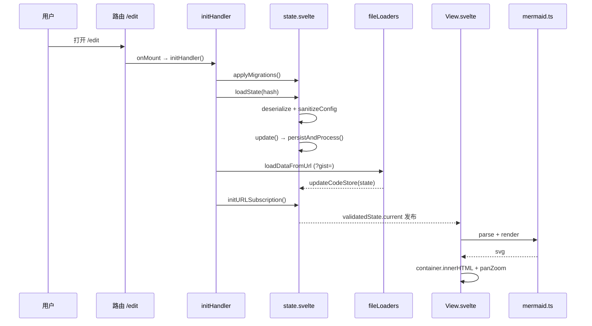

# Mermaid Live Editor — 运行原理报告

> 分析时间：2026-08-19
> 本报告逐步骤还原应用从启动到交互的完整运行机制，含变量级数据变换与状态机提取。
> 证据格式：`文件路径:行号`

---

## 1. 运行时形态

- **纯静态 SPA**：`src/routes/+layout.ts:1-4` 声明 `prerender=true, csr=true, ssr=false` —— 所有页面预渲染为 HTML 壳，逻辑全部在浏览器执行，无服务器渲染。
- **PWA**：`(app)/+layout.svelte:23-32` 注册 `${base}/service-worker.js`；`static/manifest.json` 提供安装能力（安装事件埋点 `pwaInstalled`，`edit/+page.svelte:62-64`）。
- **数据持久化三处**：
  1. localStorage（编辑草稿、历史、迁移版本、推广隐藏状态）
  2. URL hash（分享态，唯一外发载体）
  3. 远端只读：GitHub Gist API（加载）、mermaid.ink / Kroki（导出链接生成，非提交）

---

## 2. 启动流程（逐步骤）

### Step 0：模块加载期（import 副作用）

| 副作用 | 位置 | 说明 |
|--------|------|------|
| 注册 ELK / tidy-tree 布局加载器 | `mermaid.ts:8` | `mermaid.registerLayoutLoaders([...elkLayouts, ...tidyTreeLayouts])` |
| 注册 ZenUML 外部图（返回异步 init promise） | `mermaid.ts:9` | `registerExternalDiagrams([zenuml])`，render 前会 `await init`（`mermaid.ts:16`） |
| 状态单例初始化 | `state.svelte.ts:36` | `readJSON('codeStore', {...defaultState})` 读 localStorage，失败回落默认圣诞购物流程图（`constants.ts:44-57`） |
| 初始校验快照 | `state.svelte.ts:51-55` | `$state.snapshot(input)` → `validatedStateOf` + `serializeState` 同步构造 |
| 历史槽初始化 | `historyState.svelte.ts:11-14` | 三个 persisted store（auto/manual/mode）+ 内存 loader；若上次停在 loader 模式则回落 manual（`:17-19`，刷新后内存态丢失） |
| 版本埋点 | `Navbar.svelte:5-9` | module script 里上报 mermaid 版本 |

### Step 1：路由分发

- 首次进入 `/`：`(app)/+page.svelte` onMount 调 `goto(buildRedirectUrl(location), { replaceState: true })` —— 旧版 `#/{edit|view}/{state}` hash 被拆解为 `/{path}{search}#{fragment}`（`redirect.ts:8-17`），实现老链接无损迁移。
- 404：`+error.svelte` onMount 若 `page.status === 404` 则 `goto('/')`（`+error.svelte`）。
- 布局层挂载：`(app)/+layout.svelte:18-33` 注册 `hashchange → initHandler()`（用户粘贴新分享链接时全量重载状态）+ Service Worker；`:35-37` `$effect` 把 mode-watcher 暗色状态同步进 Mermaid 配置的 `theme`（经 `toggleDarkTheme`，`state.svelte.ts:280-288`，仅当主题是 dark/default 之一时才联动）。

### Step 2：edit 页初始化（`edit/+page.svelte:59-68`）

```
onMount:
  1. showEditorChooser = shouldShowEditorChooser()   // mermaid.ai 新用户弹窗
  2. await initHandler()                             // 核心编排（见 Step 3）
  3. appinstalled 事件监听 → logEvent('pwaInstalled')
onMount:
  startAutoSave()                                    // History 时间线 60s 快照
```

`shouldShowEditorChooser`（`domainMigration.ts:69-79`）决策链：
1. `env.isEnabledMermaidChartLinks` 为 false → 不显示
2. 视口 < 640px（移动端）→ 不显示
3. `?editorChooser=1` QA 强制 → 显示
4. 域名不是 mermaid.ai / mermaid.live / *.netlify.app → 不显示
5. localStorage `mermaid-editor-chooser-dismissed === 'true'` → 不显示
6. URL 带 pako/base64 数据（分享链接）→ 不显示
7. referrer 来自 mermaid 系域名 → 不显示
8. 其余 → 显示

### Step 3：`initHandler()`（`util.ts:26-37`）— 变量级流程

| 序 | 调用 | 关键变量变换 | 位置 |
|----|------|-------------|------|
| 1 | `applyMigrations()` | 读 `migrations.version`（localStorage），逐版本执行 `migrations[i]()`，每步写回版本号并埋点 | `migrations.svelte.ts:15-30` |
| 2 | `loadStateFromURL()` | `location.hash.slice(1)` → 字符串 | `util.ts:16-18` |
| 2a | └ `loadState(data)` | `deserializeState(data)`：`"pako:…"` → inflate → `JSON.parse` → `State`；`sanitizeConfig(next.mermaid)`：解析 → `findUnsafeConfigPaths` → confirm → strip → `formatJSON` | `state.svelte.ts:228-245`、`serde.ts:47-63` |
| 2b | └ 失败分支 | 保留快照 state，`code = urlParseFailedState`（一张引导排查的流程图） | `state.svelte.ts:21-30, 235-242` |
| 3 | `initLoading('Loading Gist...', loadDataFromUrl())` | `loadingState` 全屏遮罩；`loadDataFromUrl` 解析 `?code=&config=&gist=` | `loading.svelte.ts:5-14`、`loader.ts:10-59` |
| 3a | └ gist 分支 | `loadGistData(url)`：GitHub API `gists/{id}[/{rev}]` → files['code.mmd'] / files['config.json'] → `State`；修订历史 → `setLoaderEntries`（History loader 槽） | `gist.ts:42-132` |
| 4 | `syncDiagram()` | `updateCodeStore({ updateDiagram: true })` → 强制下一次渲染 | `util.ts:20-24` |
| 5 | `initURLSubscription()` | `updateHash = debounce(250ms)`；立即同步当前 serialized 进 hash | `state.svelte.ts:304-309` |
| 6 | `initAnalytics()` | 动态 import plausible-tracker（构建环境未配置则跳过） | `stats.ts:7-24` |
| 7 | `plausible.trackPageview({ url: getAnalyticsSafeUrl() })` | URL = origin+path+search，**剥离 hash** | `stats.ts:31-33` |
| 8 | `verifyState()` | `panZoom` 字段缺省时补 `true` | `state.svelte.ts:311-313` |

### Step 4：编辑器与画布挂载

- Monaco 创建：`DesktopEditor.svelte:104-189` —— `MonacoEnvironment.getWorker`（json worker / editor worker，`:105-112`）、JSON schema 绑定到 `${env.docsUrl}/schemas/config.schema.json`（`:118-127`）、`initEditor(monaco)` 注册 mermaid 语言（关键字/块关键字/类型关键字补全，`monacoExtra.ts:7-`）、双 model（`internal://mermaid.mmd`、`internal://config.json`，`:48-57`）
- 同步 effect：`DesktopEditor.svelte:191-232` —— 读 `validatedState.current` 四字段 `{errorMarkers, editorMode, code, mermaid}`；model 切换；文本差异时 `executeEdits` 全量替换（带 `isUpdatingFromState` 防回环 + undo stop）；`setModelMarkers` 显示错误波浪线
- 画布首渲：`View.svelte:113-117` effect 触发 `handleStateChange`（详见 §4）

### 启动时序图



---

## 3. 核心数据流 A：击键 → 状态 → URL（编辑主循环）

### 变量级变换表

| 步骤 | 变量 | 类型 | 值/状态变化 | 位置 |
|------|------|------|------------|------|
| 1 击键 | `newText` | `string` | Monaco model 内容 | `DesktopEditor.svelte:145` |
| 2 分流 | `editorMode` | `'code'\|'config'` | 决定走 `updateCode` 或 `updateConfig` | `Editor.svelte:16-21` |
| 3 网关 | `input` | `State` | `state.code = code`（`untrack` 内） | `state.svelte.ts:135-140, 271` |
| 4 快照 | `snapshot` | `State` | `$state.snapshot(input)` 深快照 | `state.svelte.ts:123` |
| 5 持久化 | 原文 | JSON | `localStorage['codeStore'] = JSON.stringify(snapshot)` | `persist.svelte.ts:29-33` |
| 6 序列化 | `serialized` | `string` | `JSON.stringify(state)` → `TextEncoder` → `deflate(level 9)` → base64 → `"pako:" + b64` | `serde.ts:38-45` |
| 7 校验 | `diagramType` | `string` | `mermaid.parse(code)` 成功产出（如 `'flowchart-v2'`） | `state.svelte.ts:64` |
| 8 发布 | `validatedCurrent` | `ValidatedState` | `$state.raw` 整替 | `state.svelte.ts:126` |
| 9 URL | hash | `string` | 250ms 防抖后 `history.replaceState(…, '#'+serialized)` | `state.svelte.ts:305-308` |

### 错误分支（`state.svelte.ts:72-110`）

```
mermaid.parse 抛错（含 hash.loc 行列信息）
├─ error.hash 存在？
│   ├─ 是 → extractErrorLineText(errorString)              errorHandling.ts:37-47
│   │        findMostRelevantLineNumber(lineText, code)     errorHandling.ts:2-23
│   │        （在代码行中寻找与错误行文本最长公共子串的行号）
│   │        hash.loc 解析成功 → {first_line, …last_column} :83-85
│   │        失败 → 行号 = findMostRelevantLineNumber(全文) :86-91
│   │        replaceLineNumberInErrorMessage → 重写 "Parse error on line N"
│   │        构造 MarkerData{severity:8, start/end Line/Column} → errorMarkers
│   └─ 否 → 仅记录 processed.error
└─ ZenUML 特例：上一图是 zenuml 且当前不是 → setTimeout(reload, 500)  :66-69
```

错误展示节流：编辑器下方错误条 3 秒防抖后才出现（`Editor.svelte:25-40`），避免输入中间态闪烁。

---

## 4. 核心数据流 B：状态 → 渲染（View.svelte）

### 渲染队列与去重（`View.svelte:112-117`）

```typescript
let pendingStateChange = Promise.resolve();
$effect(() => {
  const state = validatedState.current;
  pendingStateChange = pendingStateChange.then(() => handleStateChange(state).catch(() => {}));
});
```
每次状态发布把处理追加到 Promise 链尾，**天然串行**，杜绝并发渲染竞态。

### `handleStateChange` 决策树（`View.svelte:43-105`）

```
state.error !== undefined ?
├─ 是 → error=true（画布 opacity-50），return
└─ 否 → container 存在 ?
    ├─ 否 且 manualUpdate → manualUpdate=false（跳过一次）
    └─ 是 →
        code/config/rough/panZoom 四者均未变 ? → return（纯 editorMode 等变更不触发重渲）
        shouldRefreshView() 为 false ? → return（节流窗口内，已排 1s 防抖补渲）
        mayContainFontAwesome(code) ? → await waitForFontAwesomeToLoad()
        renderAndPlaceDiagram({code, config: JSON.parse(state.mermaid), container, rough, viewId})
        ├─ svg 为空串 → 仅返回 diagramType（空渲染）
        ├─ rough=true → Svg2Roughjs('#container').sketch() → 移除原 SVG → 修 sketch 尺寸/viewBox
        └─ rough=false → height=100%、maxWidth=100%、bindFunctions(graphDiv)（启用 click 交互）
        state.panZoom ? → panZoomState.updateElement(graphDiv, {pan, zoom})
        恢复 scrollTop（防渲染跳动）
        saveStatistics({code, diagramType, isRough, renderTime})
        recordRenderTime(renderTime, updater)
```

### 渲染节流状态机（`autoSync.ts`）

**状态变量**：`shouldSync`（bool，初始 true）、`renderPromise/resolveRenderPromise`（等待句柄）
**常量**：`slowRenderThreshold = 150ms`、`renderDelay = 1000ms`（`autoSync.ts:7-8`）

| 当前态 | 事件 | 动作 | 次态 |
|--------|------|------|------|
| 同步模式 | 渲染耗时 ≤150ms | 直接透传 | 保持同步 |
| 同步模式 | 渲染耗时 >150ms | `shouldSync=false`（**降级**） | 防抖模式 |
| 防抖模式 | 状态到来 | `shouldRefreshView()` 返回 false，安排 1s 防抖批量渲染 | 防抖模式 |
| 防抖模式 | 防抖到期 | `shouldSync=true; updater()` 恢复直渲 | 重新评估 |
| 任意 | `exportImage` 等待 | `waitForRender()` 返回 pending promise，渲染完成时 resolve | — |

语义：**大图编辑时自动从"每次击键即渲"退化为"1 秒批量渲染"，小图恢复实时**；`updater` 回调是 `updateCodeStore({updateDiagram:true})`（`View.svelte:102-104`）。

### 导出图像流（`Actions.svelte:108-164`）

```
点击 PNG/复制图像
→ updateCodeStore({panZoom:false})        // 关闭 panZoom 以获得原始尺寸 SVG
→ await 1000ms + waitForRender()          // 等待无 panZoom 版本渲染完成
→ 计算 canvas 尺寸（auto=2 倍原始尺寸 / width / height 模式，rough 模式取 viewBox 而非 boundingRect :120-125）
→ context 填充 --background 底色
→ getBase64SVG(svg, w, h)
    → 克隆 SVG → rough 时 fixForeignObjectClipping（foreignObject 高度×1.5 修裁切 :35-58）
    → 注入背景色 → <br>→<br/>、 自闭合（Firefox 兼容）
    → 前置 <?xml?> + FontAwesome stylesheet 声明（图标在光栅化时可用）
→ new Image().src = data:image/svg+xml;base64,… → onload → drawImage → toDataURL/toBlob
→ simulateDownload（a[download] 点击）/ ClipboardItem 写剪贴板
→ 恢复 panZoom:true（图片 onload 或 2s 兜底 :157-161）
```

---

## 5. 核心数据流 C：URL 分享与加载（serde）

### 序列化格式

```
State ──JSON.stringify──▶ JSON 文本
     ──TextEncoder──▶ Uint8Array
     ──pako.deflate(level 9)──▶ 压缩字节
     ──fromUint8Array(true)──▶ URL-safe base64
     ──前缀──▶ "pako:<base64>"
```
反序列化自动嗅探：含 `:` 且前缀 ∈ {pako, base64} → 对应算法；无前缀 → 旧版纯 base64（`serde.ts:47-63`）。未知前缀抛错 → `loadState` 捕获 → 展示 `urlParseFailedState` 排查图。

### 分享链接族（全部由 `serialized` 派生，`state.svelte.ts:150-190`）

| 链接 | 形态 | 用途 |
|------|------|------|
| 当前页 | `/edit#pako:…` | 编辑分享（URL 即状态） |
| `view` | `/view#pako:…` | 只读查看 |
| `png` / `svg` | `https://mermaid.ink/{img\|svg}/pako:…?type=png` | 远端渲染图片 |
| `kroki` | `https://kroki.io/mermaid/svg/<pako(code)>` | Kroki 兼容 |
| `mdCode` | `[](当前URL)` | Markdown 嵌入 |
| `mermaidChart(...)` | `mermaid.ai/app/plugin/save?state=…&utm_*` 等 4 个 | Mermaid Chart 集成（带 UTM 追踪） |
| `new` | `/edit#<默认状态序列化>` | 新建 |

---

## 6. 状态管理总览（状态机与生命周期）

### 6.1 localStorage 键清单

| 键 | 写入者 | 内容 | 位置 |
|----|--------|------|------|
| `codeStore` | `persistAndProcess` | 完整 `State` | `state.svelte.ts:32,124` |
| `autoHistoryStore` / `manualHistoryStore` | History | `HistoryEntry[]` | `historyState.svelte.ts:11-12` |
| `autoHistoryMode` | History | `'auto'\|'manual'\|'loader'` | `historyState.svelte.ts:13` |
| `migrations` | 迁移器 | `{version:number}` | `migrations.svelte.ts:13` |
| `hiddenPromotions` | promos | `{promoId: dismissUntilTs}` | `promo.svelte.ts:43` |
| `mermaid-editor-chooser-dismissed` | EditorChooserModal | `'true'` | `domainMigration.ts:84-86` |

### 6.2 `persisted()` rune 生命周期（`persist.svelte.ts:42-53`）

`$state.raw` 初始化时 `readJSON`（缺失/损坏/JSON null 一律回落默认值，`:12-27`）→ 每次 `set value` 整替并 `writeJSON`。设计约束：**必须整替不可原地深突变**，否则 UI 更新了但持久化不会发生（`:39-42` 注释）。

### 6.3 History 状态机（`historyState.svelte.ts`）

常量：`MAX_AUTO_HISTORY_LENGTH=30`、`AUTO_SAVE_INTERVAL=60_000`（`:8-9`）

```
三槽位:
  auto   → localStorage（FIFO 截断 30 条，:76-78）
  manual → localStorage（不截断）
  loader → 仅内存（gist 修订版本，刷新即失；mode 持久化为 loader 时启动回落 manual，:16-19）

事件:
  addEntry(slot, state) → stateKey 去重（仅 code+mermaid 的 JSON，:54-55）
                        → 头插 createEntry（uuid v4 + 两词随机 slug 名，:57-63）
  restoreEntries(data) → 校验 → 按 entry.type 路由到 auto/manual → id 去重 → 按时间排序合并 :134-157
  startAutoSave() → setInterval 60s 快照 $state.snapshot(inputState)（幂等，返回 stop 函数，:172-180）
```

### 6.4 应用级视图状态机（edit 页）

- 桌面：左右 Pane（paneforge `autoSaveId="liveEditor"` 持久化布局，`edit/+page.svelte:119`）+ 可开关 History 第三 Pane（`isHistoryOpen`）
- 移动（`width < 640`，`edit/+page.svelte:55`）：容器 `w-[200%]`，Edit/View Switch 切换 `translate-x-1/2` 滑动（`:112-116`）；编辑器 Pane 强制 50% 宽（`:73-77`）

---

## 7. Embed 组件运行原理（独立子系统）

### 7.1 构建与分发

`src/embed-loader.ts`（178 行、零依赖）→ `vite.embed.config.js` 编译为 IIFE `static/embed.js`（`minify:false` 便于审查）→ SvelteKit 构建原样发布到 `/embed.js`。

### 7.2 宿主页装载流程（`embed-loader.ts`）

```
<script src="/embed.js" async> 加载
→ resolveScriptUrl()：currentScript 为空（async）时扫描 script[src$="/embed.js"]   :31-49
→ 推导 defaultBase（loader 所在 origin + /embed）与 allowedOrigin                  :51-56
→ customElements.define('mermaid-embed', …)
→ connectedCallback → setTimeout(0)（等内联文本解析完成）→ render(element)          :163-176
   render():
     buildUrl(element)  :88-132
       ├ src 缺失且无法推导 → console.error 放弃
       ├ new URL(src) 失败 → 放弃
       ├ url.origin !== embed.js 的 origin → 拒绝（防第三方托管滥用）              :110-115
       ├ 透传属性 theme/look/mode/grid/pan/zoom/controls → query 参数              :58,117-122
       └ 元素内联文本 dedent（去公共缩进/首尾空行，:68-86）非空
          → url.hash = "code:" + encodeURIComponent(code)（代码不进 query/日志）   :126-129
     创建 iframe：sandbox="allow-scripts allow-same-origin allow-popups…"           :24-25,152
     尺寸：width 默认 100%、height 默认 480px（纯数字自动加 px，:60-65）
     WeakSet 防重复渲染                                                              :134-145
```

### 7.3 `/embed` 页解析流程（`embed.ts:88-147`）

优先级：`#code:`（内联代码）> `#pako:`/`#base64:`（完整 State）> 默认。

```
resolveEmbedSettings(url):
  hash 以 "code:" 开头 → decodeURIComponent 得原始代码
  否则 hash 非空 → deserializeState → baseState（失败 → {error:'Unable to load…'}）
  config = {...silentlySanitizeConfig(baseState.mermaid), ...silentlySanitizeConfig(?config=)}   // query 覆盖
  theme = ?theme ?? config.theme ?? 'default'
  look  = ?look  ?? config.look  ?? 'classic'
  config.securityLevel = 'strict'                          // 强制
  mode  = ?mode(light|dark) ?? isDarkTheme(theme) ? dark : light   // 主题名含 "dark" 即暗
  controls = ?controls !== '0'；grid = ?grid!=='0' && baseState.grid!==false
  pan/zoom：?pan=x,y / ?zoom=n 优先，回落 baseState
```

**与编辑器的关键差异**：不弹 confirm（`silentlySanitizeConfig` 直接剥离，`sanitize.ts:81-96`）、`securityLevel` 强制 strict、无 localStorage / 无埋点 / 无 URL 回写（`EmbedView.svelte:9-11` 约束）。

### 7.4 Share 对话框生成片段（`embedCode.ts`）

`buildEmbedUrls`（昂贵半场：sanitize+序列化）与 `buildEmbedSnippets`（廉价半场：拼字符串）分离为两个 `$derived`，宽高输入击键只重算后半场（`Share.svelte:38-53` 注释）。宽高经 `SAFE_DIMENSION` 白名单正则校验（`embedCode.ts:20`），web component 体内代码经 `escapeHtml`（仅 `&`、`<`，`:78-81`）转义。

---

## 8. 安全模型汇总

| 威胁 | 防线 | 位置 |
|------|------|------|
| 恶意 Mermaid 配置（分享链接投毒） | `sanitizeConfig`：列出与 mermaid 默认值不同的 `secure` 键路径 + `__` 前缀键（原型污染）+ 含 `<`/`>`/`url(data:` 的字符串值（XSS），confirm 后 strip | `sanitize.ts:13-54`、`state.svelte.ts:205-226` |
| embed 静默投毒 | `silentlySanitizeConfig` 无交互剥离 + `securityLevel:'strict'` | `sanitize.ts:81-96`、`embed.ts:125-126` |
| embed iframe 逃逸 | sandbox 白名单（无 allow-top-navigation/forms）；loader 校验 src origin 与 embed.js 同源 | `embedCode.ts:16-17`、`embed-loader.ts:110-115` |
| 嵌入页读写编辑器 localStorage | 代码级隔离：embed 页永不 import 状态单例（e2e 守护） | `embedCode.ts:9-12` |
| 埋点泄露图内容 | analytics URL 剥离 hash；hash 永不发送 | `stats.ts:31-33` |
| 外链跳转 | ExternalLinkWrapper 提示目标域名 | `Actions.svelte:262` 等 |

---

## 9. 错误处理链路

| 层 | 机制 | 位置 |
|----|------|------|
| 图解析 | try/catch → errorMarkers → Monaco 波浪线 + 错误条（3s 防抖） | `state.svelte.ts:72-110`、`Editor.svelte:49-82` |
| 渲染 | `handleStateChange` catch → `console.error('view fail')` + 画布半透明 | `View.svelte:96-99` |
| 渲染竞态 | Promise 链串行 + `.catch(() => {})` 吞尾部异常 | `View.svelte:116` |
| embed 渲染 | catch → 角落错误卡片（`TID.embedRenderError`） | `EmbedView.svelte:61-64,101-107` |
| URL 反序列化 | catch → 引导排查的示例图（而非白屏） | `state.svelte.ts:235-242` |
| gist 加载 | 逐修订 try/catch，全失败才抛；`initLoading(...).catch(console.error)` 不阻塞启动 | `gist.ts:103-109`、`util.ts:29` |
| localStorage 损坏 | `readJSON` 任何异常回落默认值 | `persist.svelte.ts:23-26` |
| 剪贴板 | `navigator.clipboard` 失败 → `execCommand('copy')` 离屏 textarea 兜底 | `util.ts:87-116` |
| 全局 | `+error.svelte` 展示 status/message；404 自动回首页 | `routes/+error.svelte` |

---

## 10. 性能相关机制清单

1. 渲染节流状态机（§4，150ms 阈值降级 + 1s 批量）
2. 序列化 deflate level 9（分享链接最短化，`serde.ts:22`）
3. hash 回写 250ms 防抖（避免打字时每帧 replaceState，`state.svelte.ts:305`）
4. vendor chunk 长缓存 + embed.js 独立构建（互不失效）
5. `$state.raw` 快照整替避免深度代理开销（`state.svelte.ts:53`）
6. Share 对话框昂贵/廉价派生分离（`Share.svelte:38-53`）
7. ResizeObserver 驱动 Monaco/panZoom 自适应布局（`DesktopEditor.svelte:169-178`、`panZoom.ts:19-24`）
8. 已知热点：`findMostRelevantLineNumber` 的 O(n·L²) 子串枚举（`errorHandling.ts:9-16`）——长文档错误行匹配可能是卡顿源
