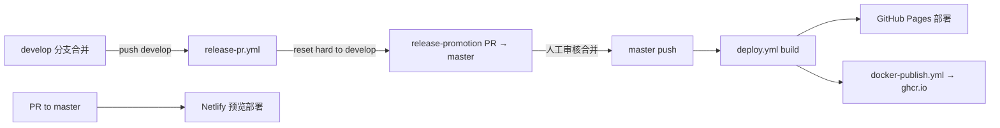

# Mermaid Live Editor — 工作流报告

> 分析时间：2026-08-19
> 覆盖：开发工作流、CI/CD 管线、测试策略、发布流程、业务工作流（含决策树与异常恢复）。
> 证据格式：`文件路径:行号`

---

## 1. 开发工作流

### 1.1 本地开发命令（`package.json:6-26`、`CLAUDE.md:5-14`）

| 命令 | 作用 | 备注 |
|------|------|------|
| `pnpm dev` | 先 `build:embed` 再 Vite dev server（端口 3000） | HMR 被禁用为全量刷新（`vite.config.js:12-18`） |
| `pnpm dev:force` | `MERMAID_LOCAL=true pnpm dev --force` | 使用本地 mermaid 联调 |
| `pnpm build` | `build:embed` + `vite build` → `docs/` | `docs/` 是构建产物，禁止手改（CLAUDE.md） |
| `pnpm check` | svelte-check 类型检查 | |
| `pnpm lint` / `lint:fix` | prettier + eslint | ESLint 强制 5+ 键对象字母序（`sort-keys`，CLAUDE.md:66） |
| `pnpm test:unit` | vitest（watch 模式） | jsdom 环境，支持 in-source 测试（`vite.config.js:38-55`） |
| `pnpm test:e2e` | Playwright | 本地自动起 dev server，CI 用 preview 对生产构建测试（`playwright.config.ts:22-27`） |
| `pnpm test` | unit + e2e 全量 | |

### 1.2 提交前钩子（husky + lint-staged）

- `postinstall`：husky 安装 + svelte-kit sync + 配置 `.git-blame-ignore-revs`（`package.json:19`）
- `pre-commit` → `lint-staged`：`*.{ts,svelte,js,css,md,json}` 跑 prettier --write + eslint（`package.json:120-125`）

### 1.3 分支与协作模式

- 日常开发在 `develop`；功能分支（如 `feat/embed`、`feat/rename-history-entries`）经 PR 合入（近期 git log 显示 PR 编号已至 #2016）
- `master` 为发布分支：对 master 的 PR 由 Netlify 构建预览（README:118-121），合并即发布
- 依赖升级由 renovate（`renovate.json`，mermaid 系依赖单独成组，commit `fd87a0f9`）与 dependabot 自动提 PR
- Git 历史中使用 `.git-blame-ignore-revs` 屏蔽批量格式化提交的 blame 干扰

---

## 2. CI/CD 管线（.github/workflows/）

### 2.1 管线总览

| Workflow | 触发 | 作用 |
|----------|------|------|
| `unit-tests.yml` | PR → master/develop + merge_group | lint → svelte-check → vitest（`unit-tests.yml:31-44`） |
| `tests.yml` | PR → master/develop + merge_group | pnpm build → Playwright e2e（Playwright 官方容器镜像 v1.60.0-jammy，对**生产构建**测试；工件上传 7 天，`tests.yml:11-55`） |
| `deploy.yml` | push → master；PR → master/develop | 构建静态站点 → master push 时部署 GitHub Pages（`deploy.yml:1-63`） |
| `release-pr.yml` | push → develop | 检出 master → reset --hard develop → 创建 `release-promotion` PR（`release-pr.yml:1-20`） |
| `docker-publish.yml` | （发布镜像到 ghcr.io） | 多阶段构建 node:24-alpine → nginx:1.28-alpine（`Dockerfile`） |
| `codeql-analysis.yml` | 定期/PR | GitHub CodeQL 安全扫描 |
| `update-browserlist.yml` | 定时 | 更新 browserslist 数据 |
| `close-broken-link-issues.yml` | 定时 | 自动关闭无效链接 issue |

### 2.2 发布流水线（develop → 生产）



生产环境变量（`deploy.yml:31-36`、`netlify.toml`，两处一致）：
`MERMAID_DOMAIN=mermaid.live`、`MERMAID_ANALYTICS_URL=https://p.mermaid.live`、`MERMAID_RENDERER_URL=https://mermaid.ink`、`MERMAID_KROKI_RENDERER_URL=https://kroki.io`、`MERMAID_IS_ENABLED_MERMAID_CHART_LINKS=true`。未配置时（本地/自建）这些功能自动禁用（`env.ts:1-10` 全部带空默认）。

PR 构建会保留 `docs/_app/`（缓存指纹资产），master 构建则删除以获得干净 immutable 输出（`deploy.yml:39`）。

### 2.3 Docker 渠道

`Dockerfile` 三阶段：依赖层（apk build-base/git/python3 + pnpm install）→ 构建层（ARG 注入全部 MERMAID_* 构建参数 → pnpm build）→ 运行层（nginx:1.28-alpine 托管 `docs/`）。README:26-58 说明官方镜像不可覆盖环境变量，需自行构建。另有 `mermaid-dev` 阶段直接跑 `pnpm dev`。

---

## 3. 测试策略

### 3.1 测试矩阵

| 类型 | 框架 | 位置 | 数量 | 说明 |
|------|------|------|------|------|
| 单元测试 | Vitest 4 + jsdom + vitest-dom + chai | 与源码同目录 `*.test.ts` | 11 个 | 覆盖：serde、state、persist、sanitize、stats、redirect、migrations、mermaid 包装、historyState（360 行最大）、embed、embedCode |
| in-source 测试 | `import.meta.vitest` | `vite.config.js:41` includeSource | — | 已启用 |
| E2E | Playwright（仅 chromium） | `tests/*.spec.ts` | 8 个 | loadSite、diagramUpdate、actions、docMap、embed、errorDisplay、history、themes |

### 3.2 E2E 配置要点（`playwright.config.ts`）

- `webServer`：本地复用已运行的 dev server（`reuseExistingServer: !CI`），CI 用 `pnpm preview` 对生产构建测试
- 授权 clipboard-read/write（测复制功能，`:18`）
- CI 重试 2 次、3 worker（`:13,27`）——CLAUDE.md:19 提示本地并行 worker 可能 flaky，建议 `--workers=1` 复核
- 测试选择器统一用 `TID` 常量（`src/lib/constants.ts:3-21`，如 `download-PNG`、`embed-snippet`），避免依赖样式类

### 3.3 覆盖评估

- **覆盖良好**：序列化/消毒/持久化/重定向/迁移/历史/embed URL 解析与片段生成（纯函数均有对应测试）
- **依赖 E2E 兜底**：渲染管线（View/renderView/panZoom）、导出图像、Monaco 编辑器行为
- **薄弱区**：`errorHandling.ts` 行号映射算法、`autoSync.ts` 节流状态机、`monacoExtra.ts`（622 行语言定义）无专门单测

---

## 4. 业务工作流映射（用户视角）

### 4.1 业务流程清单

| # | 流程 | 主要代码 | 参与方 |
|---|------|---------|--------|
| 1 | 编辑-实时预览循环 | `Editor.svelte` → `state.svelte.ts` → `View.svelte` | 用户、mermaid 引擎 |
| 2 | 分享（链接/嵌入代码） | `state.svelte.ts:150-190`、`Share.svelte`、`embedCode.ts` | 用户、mermaid.ink、mermaid.ai |
| 3 | 导出（PNG/SVG/剪贴板/Markdown） | `Actions.svelte:108-223` | 用户、canvas、远端渲染器 |
| 4 | 从 Gist 加载（含修订时间线） | `loader.ts`、`gist.ts` | 用户、GitHub API |
| 5 | 历史时间线（自动/手动/恢复） | `historyState.svelte.ts`、`History.svelte` | 用户、localStorage |
| 6 | 嵌入第三方网站 | `embed-loader.ts`、`/embed`、`EmbedView.svelte` | 宿主页作者、访客 |
| 7 | 状态迁移（旧链接/旧数据） | `redirect.ts`、`migrations.svelte.ts` | 老用户 |

### 4.2 流程 4 决策树：Gist 加载（`loader.ts:10-59` + `gist.ts:91-132`）

```
URL 是否含 ?code= ?
├─ 是 → fetchText(codeURL) 得 code；?config= 存在则 fetchText 得 config
│      → state = {code, mermaid: config, loader: {type:'files', config:{codeURL, configURL}}}
├─ 否 → 遍历 searchParams 找已注册 loader（当前仅 gist）
│      ├─ ?gist=<github URL> → loadGistData:
│      │    路径拆出 gistID[/revisionID] → GET api.github.com/gists/…
│      │    ├─ files 无 'code.mmd' → throw 'Invalid gist provided'
│      │    ├─ file.truncated → fetchText(raw_url) 取全文（:20-25）
│      │    ├─ 遍历 history[] 逐版本 getGistData → 失败仅 console.error 跳过（:104-109）
│      │    ├─ 全部失败 → throw
│      │    └─ 最新版为当前 state；全部版本倒序入 loader 时间线（:114-130）
│      └─ 未匹配 → 不加载（loaded=false）
加载成功后：state.mermaid = sanitizeConfig(...)（交互式确认剥离危险配置）→ updateCodeStore({...state, updateDiagram:true})
```

### 4.3 流程 2 决策树：分享

```
用户点 Share
├─ 复制当前 URL（#/pako:…）→ 任何接收者打开即恢复完整状态
├─ env.isEnabledMermaidChartLinks ? → 展示 Mermaid Chart Playground 链接（带 utm_medium=share）
└─ Embed 面板：
    theme/look/mode/controls/grid/width/height 输入
    ├─ 预览开关 → iframe sandbox 实时预览（Share.svelte:155-162）
    ├─ iframe 格式 → <iframe src="{host}/embed?{qs}#pako:…" sandbox=…>
    └─ Web component 格式 → <script src="{host}/embed.js" async> + <mermaid-embed …>代码体</mermaid-embed>
```

### 4.4 异常恢复路径汇总

| 流程步骤 | 失败点 | 处理 | 恢复策略 | 位置 |
|---------|--------|------|---------|------|
| 分享链接加载 | pako/base64 损坏 | catch → 展示排查引导图（`urlParseFailedState`） | 用户自查/提 issue | `state.svelte.ts:235-242` |
| 配置含危险键 | sanitizeConfig | confirm 询问；确认剥离 / 取消保留 | 用户显式信任可保留 | `state.svelte.ts:211-224` |
| gist 某修订损坏 | GitHub API/内容 | 逐修订 try/catch 跳过 | 其余修订仍可用 | `gist.ts:103-109` |
| 嵌入 hash 解析失败 | embed.ts | `{error}` → 错误卡片 + 新建链接 | 无自动重试（静态内容） | `embed.ts:110-112`、`embed/+page.svelte:61-72` |
| 嵌入渲染失败 | mermaid 抛错 | catch → 角落错误提示，页面其余部分可用 | 手动修正代码 | `EmbedView.svelte:61-64` |
| 导出图像 onload 不触发 | 图片解码失败 | 2 秒兜底恢复 panZoom，避免界面卡在禁用态 | 定时兜底 | `Actions.svelte:157-161` |
| 剪贴板 API 失败 | 权限/兼容 | execCommand 离屏 textarea 降级 | 同步降级 | `util.ts:87-116` |
| 慢渲染 | 大图 >150ms | autoSync 降级为 1s 批量 | 自动恢复（阈值重估） | `autoSync.ts:15-39` |
| localStorage 损坏 | JSON.parse 抛错 | 回落默认值 | 数据丢失但有界面 | `persist.svelte.ts:23-26` |
| ZenUML 残留状态 | 外部图污染 | 500ms 后整页 reload | 自愈 hack | `state.svelte.ts:66-69` |

**缺乏容错的点**（人工标注）：`fetchJSON/fetchText`（`util.ts:78-85`）无超时/重试；gist API 限流（60 次/小时未认证）时仅控制台报错，UI 无提示（`util.ts:29` `.catch(console.error)` 吞掉）。

---

## 5. 商业集成工作流（Mermaid Chart）

代码中大量 `McWrapper`（env 开关门控组件）与 UTM 追踪构成商业漏斗：

| 触点 | medium | 位置 |
|------|--------|------|
| Save diagram 按钮 | `save_diagram` | `edit/+page.svelte:99-108` |
| Share 对话框 Playground | `share` | `Share.svelte:84` |
| AI Repair（语法错误条） | `ai_repair` | `Editor.svelte:63-76` |
| 行内 AI 提示浮层（Monaco gutter） | `vibe_diagramming` | `DesktopEditor.svelte:243-251`、`AIPromptPopup.svelte` |
| Enhanced Edits 按钮（语音/AI 编辑轮播，30s 切换） | `voice_edit` / `ai_edit` | `EnhancedEditsButton.svelte:16-50` |
| 主菜单 Playground/Plugins | `main_menu` | `MainMenu.svelte` |
| 推广横幅（日期区间 + 关闭 1 周） | banner | `promo.svelte.ts:18-31`、`Navbar.svelte:59-81` |
| 编辑器选择弹窗（仅 mermaid.ai/live 新访客） | chooseEditor | `domainMigration.ts:69-79`、`EditorChooserModal.svelte` |

所有 Mermaid Chart 链接都由 `urls.current.mermaidChart({medium, campaign})` 统一构造（`state.svelte.ts:157-184`），UTM source 依域名区分 `ai_live_editor` / `mermaid_live_editor`（`util.ts:118-123`）。自部署（未开 `MERMAID_IS_ENABLED_MERMAID_CHART_LINKS`）时全部隐藏，且 `MCBaseURL` 指向 `example.com` 防误点（`env.ts:12-14`）。

---

## 6. 埋点事件工作流（stats.ts）

- 事件注册表 `delaysPerEvent`（`stats.ts:91-108`）：每事件独立防抖窗口（点击类 0、普通 1 分钟、render 5 分钟）
- `logEvent`（`:112-132`）：localhost 只打印不上报；重复 key 在窗口内被吞（降采样）
- `saveStatistics`（`:39-57`）把代码行数与渲染时长**分桶**后随 `render` 事件上报（避免高基数）
- 仪表盘公开：https://p.mermaid.live/mermaid.live（`stats.ts:15` 注释）

---

## 7. 版本与发布记录约定

- `package.json:3` 版本号 `2.0.67`（发布流程由 release-promotion PR 承载，未见自动 bump 脚本 —— CI 中无 version bump 步骤，版本号靠人工维护）
- 本仓库 `note/release/` 目录约定存放各版本变更记录（全局规则要求；当前尚无历史文件）

---

> 相关阅读：[01-architecture.md](01-architecture.md)、[02-operation-principles.md](02-operation-principles.md)、[04-ai-substitution.md](04-ai-substitution.md)
